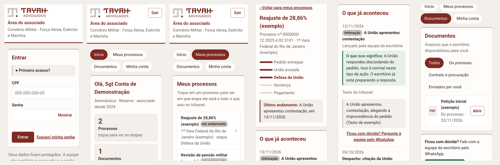
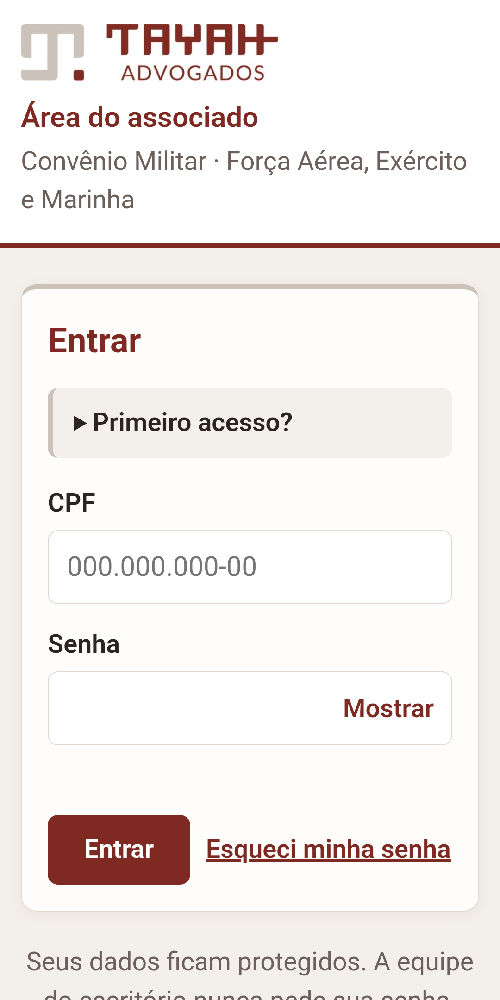
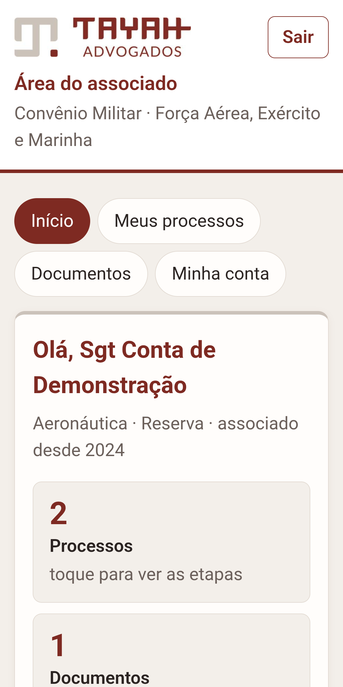
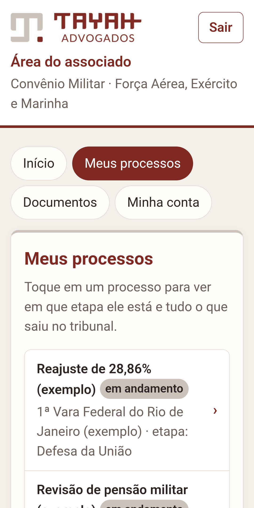
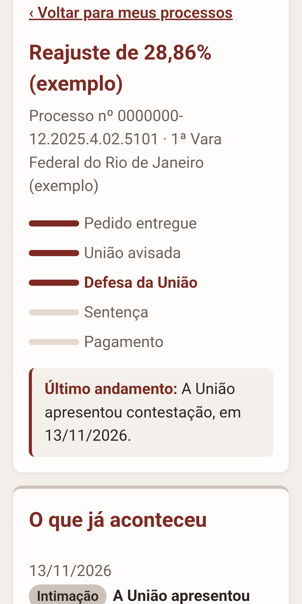
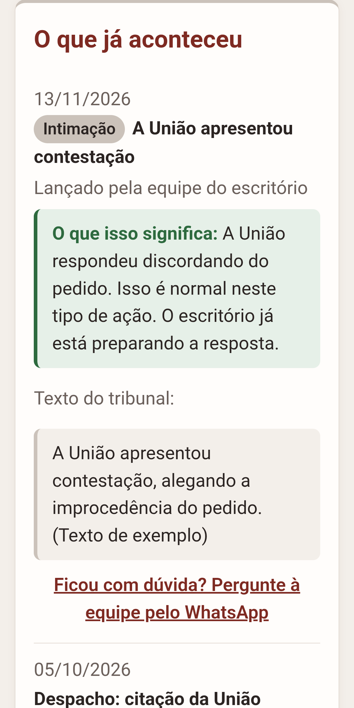
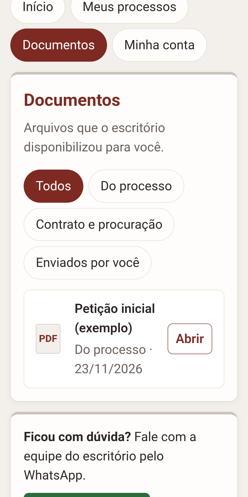

  

<h1 align="center">Tayah Associado</h1>

  App Android e web para associados militares acompanharem os próprios processos judiciais, 
  com explicação de cada andamento em linguagem simples.

  

> Projeto real, feito para um escritório de advocacia (Tayah Advogados). Por ser um sistema com dados de clientes, o código é privado. Esta página mostra o que foi construído e como. As telas acima são de uma **conta de demonstração com dados fictícios**.

## O problema

O escritório atende muitos militares (Exército, Marinha e Aeronáutica) em ações coletivas e individuais. A dúvida mais comum era sempre a mesma: *"como está o meu processo?"*. Cada resposta exigia que alguém da equipe consultasse o tribunal e traduzisse o juridiquês pelo WhatsApp.

## A solução

| Para o associado (app) | Para a equipe (painel web) |
|---|---|
| Login com CPF e senha própria | Cadastro de associados e criação de acesso |
| Lista dos processos e a **etapa atual** de cada um | Lançamento de andamentos e da explicação em linguagem simples |
| Linha do tempo com o texto do tribunal **e** o que ele significa | Robô que busca as novidades nos tribunais todo dia |
| Aviso no celular quando há novidade | Revisão antes de publicar sentenças e decisões |
| Documentos (contrato, procuração, peças) em PDF | Pasta de documentos protegida para cada associado |
| Pedido de exclusão da conta dentro do app | Fila de pedidos de exclusão (LGPD) |
| Botão para tirar dúvida pelo WhatsApp | Acesso só com verificação em duas etapas |

## Destaques técnicos

**Segurança e privacidade (LGPD)**
- Cada associado vê **apenas** os próprios dados. A regra está no banco de dados (Row Level Security do PostgreSQL), não só na tela, e tem teste automático que tenta ler os dados de outro associado e precisa ser barrado.
- Equipe só entra com 2FA (TOTP). Funções sensíveis rodam no servidor, e a chave administrativa nunca vai para o app.
- Documentos abrem por link temporário, que expira em 1 minuto.
- O aviso no celular não leva nome, CPF nem conteúdo do processo: só um texto genérico.
- Exclusão de conta pelo app e por página web, com prazo e confirmação, como a Play Store exige.

**Robô de andamentos**
- Roda todo dia, agendado no próprio banco (pg_cron). Consulta as fontes públicas do CNJ: o Diário de Justiça Eletrônico Nacional (DJEN) e a API do DataJud.
- Não duplica andamentos e se recupera sozinho se falhar um dia.
- Sentenças e decisões ficam **retidas por 3 dias úteis**, calculados com tabela de feriados nacionais e estaduais (inclusive os móveis, como Carnaval). Assim a equipe explica a decisão antes que o cliente a veja sozinho.

**App**
- Um único código web (HTML, CSS e JavaScript, sem framework), empacotado como app Android com Capacitor.
- Notificações push com Firebase Cloud Messaging, enviadas por uma Edge Function.
- Tela própria para quando o celular fica sem internet, que volta sozinha quando a conexão retorna.
- Pronto para a Play Store: build assinado, ficha da loja, formulários de segurança dos dados e política de privacidade.

## Tecnologias

`JavaScript` · `HTML/CSS` · `Capacitor 8 (Android)` · `Supabase` (PostgreSQL, Auth, Storage, Edge Functions em TypeScript/Deno) · `Row Level Security` · `pg_cron` · `Firebase Cloud Messaging` · `APIs do CNJ (DJEN e DataJud)` · `Python (Pillow)` para gerar ícones e imagens da loja

## Como foi feito

- Em etapas semanais, cada uma com teste automático, registro da decisão tomada e um critério de "pronto" que precisava passar.
- **Testes que podem falhar:** para cada teste de segurança, conferi que ele reprova quando a proteção é desligada de propósito.
- Ambiente de teste separado, só com dados fictícios. Nenhum dado real de cliente em teste, em IA ou em repositório.
- Desenvolvido com apoio de IA (Claude Code) como par de programação, com revisão e testes de cada entrega.

## Telas

| Login | Início | Processos |
|---|---|---|
|  |  |  |

| Etapas | Novidade explicada | Documentos |
|---|---|---|
|  |  |  |

---

Marca e nome Tayah pertencem ao Tayah Advogados. Esta página é só uma apresentação do trabalho. Os dados das telas são fictícios.
